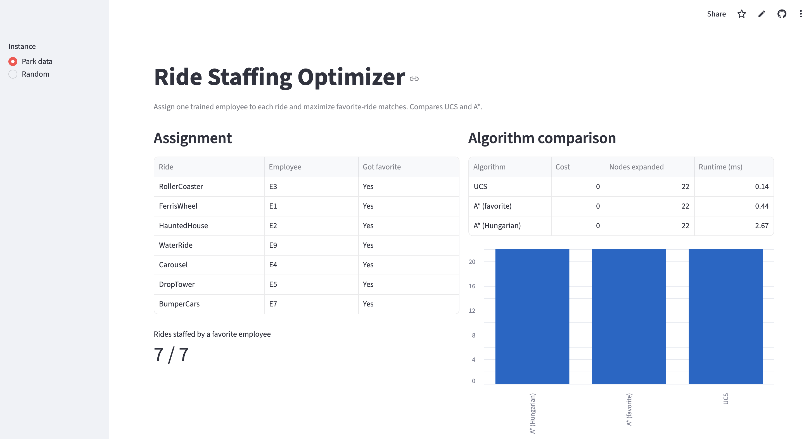

# Ride Staffing Optimizer

Assigns one trained employee to each amusement park ride and maximizes how many employees get their favorite ride. Compares Uniform Cost Search (UCS) and A* with two admissible heuristics, and validates every result against the Hungarian algorithm.

**Live demo:** https://searchproblemai-ksdc9frvwt3inpy2nfbgrv.streamlit.app/



## Features
- Unified search engine where UCS is A* with a zero heuristic
- Two admissible heuristics: favorite-ride count and Hungarian relaxation
- Hungarian algorithm baseline (SciPy) to prove optimality
- Seeded random instance generator for reproducible experiments
- Interactive Streamlit dashboard with assignment table, bipartite graph, and algorithm comparison charts
- Pytest suite covering optimality, heuristic admissibility, and infeasible instances

## Run locally
```bash
pip install -r requirements.txt
streamlit run app.py
pytest
```

## How it works
- **State:** a tuple with one employee slot per ride
- **Action:** assign an untaken, trained employee to the next empty ride
- **Cost:** 0 if the employee is on their favorite ride, otherwise 1
- **Goal:** every ride staffed at minimum total cost
- Admissible heuristics never overestimate, so A* always returns an optimal assignment

## Project structure
- `assignment.py` problem definition, search, heuristics, baseline
- `app.py` Streamlit dashboard
- `test_assignment.py` tests
